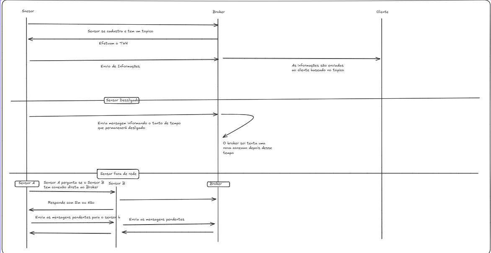
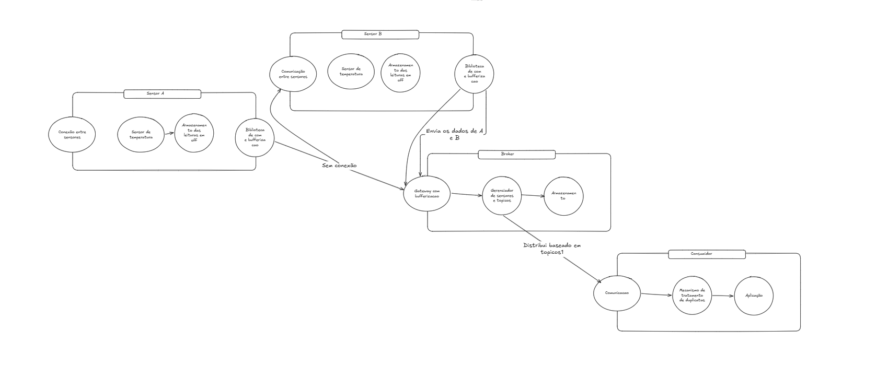

Relatório: Projeto Middleware Publish/Subscribe   
Disciplina: Programação Distribuída  
Alunos: João Pedro Marques Araújo Rodrigues Aragão e Lucas Emanuel Araújo Toscano

# Etapa 0 \-  Reflexão do Projeto Maktuf

O cenário escolhido para o projeto foi o cenário A \- Telemetria de Sensores Remotos

Biólogos marinhos instalam sensores de baixo consumo para monitorar a temperatura da  
água. Os sensores se conectam de forma intermitente: ficam horas offline (economia de  
bateria, perda de sinal) e depois voltam. Alguns sensores enviam poucas leituras por dia;  
outros, um fluxo contínuo. O serviço de coleta não pode ficar indisponível quando um  
sensor falha ou some, e um sensor lento ou em má conexão não pode atrasar a entrega  
dos dados dos outros. Restrições: baixo volume, latência relaxada, alta confiabilidade por  
mensagem.

Requisitos do Cenário A:

- Lidar com alta confiabilidade de mensagem.  
- Alta disponibilidade  
- Atraso de outros sensores não devem afetar os demais  
- Lidar bem com atemporalidade

Restrições do Cenário A:

- Baixo volume  
- Latência Relaxada  
- Dispositivos com conexão intermitente, podendo ficar sem comunicação por um período de tempo. 

Os dispositivos podem passar horas offline, 

Trabalho Relacionado:   
[A Community-Based Event Delivery Protocol in Publish/Subscribe Systems for Delay Tolerant Sensor Networks](https://www.mdpi.com/1424-8220/9/10/7580) 

[https\://sol.sbc.org.br/index.php/sbcars/article/view/30227](https://sol.sbc.org.br/index.php/sbcars/article/view/30227) 

# Etapa 1 \- Documento do Projeto 

## Componentes do sistema:

- Sensor Publicador \- Produz mensagem com as leituras de temperatura e publica nos tópicos.  
- Serviço Consumidor \- Consome e utiliza as mensagens.  
- Broker \- Recebe as mensagens, gerencia os tópicos e encaminha as mensagens.  
- Biblioteca de Comunicação \- Oferece funções para conexão, publicar mensagens, se inscrever em tópicos, cancelar inscrições.

## Restrições que afetam o componente:

- Sensor offline: o sensor guarda suas leituras em um buffer persistente.  
- Os sensores quando vão ficar offline para guardar energia fazem uso de uma mensagem avisando quanto tempo eles vão ficar desligados  
- Para que um sensor lento ou com muitas mensagens acumuladas não prejudique os demais, o broker mantém uma fila separada e com tamanho limitado para cada sensor, e processa as conexões de forma assíncrona (cada sensor é atendido de forma independente). 

## Estrutura da mensagem e QOS

- As mensagens são publicadas em tópicos por sensor, o que desacopla sensores e consumidores e facilita a ordenação por sensor.   
- Além dos tópicos de envio de mensagens normais teria um tópico específico para os estados dos sensores  
- As mensagens teriam a garantia de entrega de "**Pelo Menos uma Mensagem**"   
- As mensagens teriam **ordenação particionada** pelo Sensor  
- As mensagens seriam binarizadas  
- Broker duplicado em caso de falha no primário o segundo assume

## Protocolos

- TCP para conexão  
- Desenvolvimento de um protocolo de aplicação próprio baseado no MQTT

## Tradeoffs

- Entrega "pelo menos uma vez": Garante que nenhuma leitura se perde, porém a mesma mensagem chega mais de uma vez, os consumidores precisam de uma lógica implementada para evitar as duplicatas  
- Ordenação particionada por sensor: As leituras de cada sensor chegam em ordem, sem que um sensor precise esperar os outros para a ordenação total. Em troca o processamento fica no broker para manter a ordem de cada sensor   
- TCP entre sensor e broker: Garante uma entrega confiável e ordenada na conexão, mas em compensação gasta mais energia para cada entrega  
- Idade de leitura em vez de hora absoluta: os sensores não precisam de relógio sincronizado  
- Buffer no sensor Leituras não devem se perder durante as horas apesar de gastar mais energia e armazenamento, é o campo ideal para ter uma ressalva das leituras.  
- Fila separada e limitada por sensor no broker: Um sensor lento ou com muitas mensagens acumuladas não vai atrasar os outros devido a uma fila separada para cada sensor  
- Broker Replicado: O sistema precisa de alta disponibilidade então é feita a duplicação do broker para caso este falhe outro pode assumir, porém fica mais complexo de gerenciar os estados entre n brokers

Em suma, foi identificado que vão ser necessários 4 componentes principais: sensores, brokers, consumidores e uma biblioteca de comunicação. Para uma assegurar o funcionamento correto do sistema foram previstas as seguintes situações, quando o sensor ficar offline por problemas de rede todas as leituras dele seriam guardadas em um buffer interno persistente, descartando o mais antigo, além disso dito que um dos requisitos é que um sensor não atrapalhe o outro cada sensor seria uma fila para o envio de mensagens em um broker, ou seja, um sensor que envia dezenas de mensagens seria parado não impedindo a mensagens dos outros sensores. As mensagens enviadas pelos sensores serão baseadas em tópicos, onde o consumidor pode se inscrever em múltiplos tópicos incluindo um tópico especial, feito para a comunicação de estados dos sensores. Dado a alta confiabilidade que o sistema deve ter a escolha foi de **Pelo menos uma**  mensagem, para garantir que exista isso sem que exija muito poder computacional do broker, além dessa garantia o sistema teria **Ordenação Particionada** pelo sensor garantindo que ao menos exista ordenação sem também afetar demais a carga do broker. Todas as mensagens seriam binarizadas para a transmissão de dados a fim de evitar carga de rede devido a dados estruturados, a decodificação ficaria a cargo do consumidor. Para a rede seria utilizado o protocolo já feito o TCP e para a implementação do Middleware seria baseado no protocolo MQTT.  
Além disso no contexto de alta disponibilidade o Broker seria replicado, tendo sempre um número ímpar, a princípio funcionará com apenas 2 brokers e 1 Juiz que seria uma espécie de broker que somente checaria se os brokers estão funcionando normalmente e que cuidaria da parte de sincronização entre os brokers, informando quando o reserva pode assumir e servindo como ajudante. Os sensores enviariam a idade da leitura ao invés da data e deixariam com que o broker fizesse o cálculo da leitura ao invés do próprio sensor.

## Arquitetura

### Diagrama de Sequência 

#### Rascunho

#### Diagrama completo realizado com ajuda de IA

### Diagrama de Componentes 

#### Rascunho

#### Definitivo com ajuda de IA 

