Relatório: Projeto Middleware Publish/Subscribe
Disciplina: Programação Distribuída
Alunos: João Pedro Marques Araújo Rodrigues Aragão e Lucas Emanuel Araújo Toscano

# Etapa 3 - Avaliação de desempenho e relatório final do Maktuf

Este relatório fecha o projeto. Ele cobre:

- o cenário escolhido e as metas que saíram dele (seção 1);
- a solução final implementada (seção 2);
- os tradeoffs do projeto final (seção 3);
- a metodologia e os resultados das avaliações de desempenho (seções 4 e 5);
- os ajustes feitos a partir das medições (seção 6);
- as dificuldades encontradas e como foram resolvidas (seção 7);
- as limitações que ficaram (seção 8).

Os requisitos citados (`RF-*`, `RNF-*`, `DP-*`) estão em
[requisitos.md](requisitos/requisitos.md). O protocolo está em
[protocolo.md](protocolo.md).

## 1. Cenário escolhido

**Cenário A, telemetria de sensores remotos.** Biólogos marinhos instalam
sensores de baixo consumo para medir a temperatura da água. Os sensores se
conectam de forma intermitente: ficam horas sem conexão, para poupar bateria
ou por falta de sinal, e depois voltam. Alguns enviam poucas leituras por dia;
outros mandam um fluxo contínuo. O serviço de coleta não pode parar quando um
sensor falha ou some, e um sensor lento ou com conexão ruim não pode atrasar
os outros.

As restrições do cenário são:
- baixo volume;
- latência relaxada;
- alta confiabilidade por mensagem;
- dispositivos com conexão intermitente.

Na Etapa 1, essas restrições viraram metas mensuráveis:

| Restrição do cenário | Meta | Requisito |
|---|---|---|
| Latência relaxada | p95 ≤ 5 s e p99 ≤ 10 s em operação normal | RNF-01 |
| Baixo volume | 200 sensores: 90% com 1 leitura a cada 5 min e 10% com 1 leitura/s (~20,6 leituras/s) | RNF-03 |
| Conexão intermitente | Rajada de 2.000 leituras absorvida sem recusar conexões nem perder leituras confirmadas | RNF-04, RF-35 |
| Um sensor não atrasa os outros | p95 de um sensor normal ≤ 2× a linha de base + 0,5 s com outro sensor saturado (folga absoluta revista na Etapa 3, seção 7.3) | RNF-05 |
| Alta disponibilidade | Failover em até 30 s (RTO) | RNF-06 |
| Alta confiabilidade | Nenhuma leitura confirmada perdida (RPO = 0) | RNF-07 |

## 2. Solução final implementada

O Maktuf é um middleware Publish/Subscribe escrito em Go 1.22, sem
dependências externas. Tem cerca de 11 mil linhas de código, sem contar os
testes, e 211 testes automatizados.

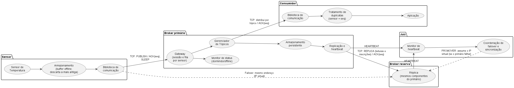

### 2.1 Componentes

| Componente | Pacote / executável | Papel |
|---|---|---|
| Protocolo | `internal/protocol` | Protocolo binário próprio sobre TCP, inspirado no MQTT (versão 3, 15 tipos de mensagem, inteiros big-endian, quadro máximo de 1 MiB) |
| Broker | `internal/broker`, `cmd/broker` | Tópicos dinâmicos com curingas, sessão e fila limitada por sensor, fila justa entre sensores, fila e cursor por assinante, store persistente (WAL com fsync), monitor de sono/offline |
| Replicação | `internal/replication` | Replicação síncrona primário → reserva: cada registro do store é confirmado pela reserva (`REPLICA_ACK`) antes do ACK ao cliente |
| Juiz | `internal/juiz`, `cmd/juiz` | Heartbeats, detecção de falha, promoção da reserva e proteção contra dois primários (split-brain); fica fora do caminho dos dados |
| Endereço virtual | `internal/vip`, `cmd/vip` | Proxy TCP que leva cada conexão ao broker que aceita o `CONNECT` (o primário atual) |
| Biblioteca cliente | `internal/client` | Conexão, reconexão com backoff, buffer durável do sensor, reenvio em ordem, deduplicação por `sensor_id + seq`, restauração de inscrições |
| Persistência | `internal/storage` | Buffer em disco do sensor e log de registros do broker |
| Métricas | `internal/metrics` | Contadores, medidores e histogramas expostos em `/metrics`, no formato textual do Prometheus |
| Aplicações de teste | `cmd/sensor`, `cmd/consumidor`, `examples/runner` | Simulador de N sensores, consumidor com verificação de ordem/lacunas/latência, gerador de carga e falhas |

### 2.2 Caminho de uma leitura

1. O sensor grava a leitura no **buffer persistente** (fsync) com um `seq`
   crescente e a envia em um `PUBLISH`. O pacote leva a idade da leitura
   (`age_ms`), não a hora absoluta (35 bytes no exemplo do protocolo).
2. O primário grava a leitura no store (fsync), replica o registro na reserva
   e espera o `REPLICA_ACK` (outro fsync). Só então responde
   `PUBACK(PERSISTED)`, e o sensor apaga a leitura do buffer.
3. A leitura entra na fila de cada assinante e é entregue com `DELIVER`. O
   consumidor confirma com `DELIVER_ACK`, que também vai para o store e é
   replicado.
4. Sem inscritos, o broker responde `PUBACK(NO_SUBSCRIBERS)` e descarta a
   leitura, sem perda silenciosa (DP-02).

### 2.3 Garantias oferecidas

- **Pelo menos uma vez:** reenvio até o `PUBACK` e até o `DELIVER_ACK`. As
  duplicatas são descartadas pela biblioteca por `sensor_id + seq` (DP-09).
- **Ordem por sensor:** um `PUBLISH` em voo por sensor, `seq` monotônico e
  cursor por assinante. A ordem se mantém depois de reconexão e de failover
  (RNF-11).
- **Isolamento:** sessão e fila limitadas por sensor, com backpressure (o
  broker para de ler o socket daquele sensor), e escalonamento por fila
  justa (DP-18).
- **Consumidor lento:** fila por assinante com retenção limitada. Ao estourar,
  a leitura mais antiga é descartada e a próxima chega marcada com
  `GAP_BEFORE`: a perda é explícita, nunca silenciosa (DP-07).
- **Sono e estado:** o sensor avisa com `SLEEP` quanto tempo vai dormir. O
  broker publica `dormindo`, `offline` (prazo vencido) e `online` no tópico
  `sensores/{id}/status`.
- **Disponibilidade:** dois brokers e um Juiz. Na queda do primário, o Juiz
  promove a reserva sincronizada, e os clientes reconectam pelo vip sem saber
  que o broker mudou. O antigo primário volta como reserva.

## 3. Tradeoffs do projeto final

| Decisão | O que ganha | O que custa | Evidência na Etapa 3 |
|---|---|---|---|
| Entrega "pelo menos uma vez" com dedup no cliente (DP-09) | Nenhuma leitura confirmada se perde, sem o custo de um protocolo "exatamente uma vez" | Duplicatas na rede depois de falhas; o consumidor precisa deduplicar | `queda_primario`: 0 perdidas e 0 repetidas em 1.706 leituras |
| `PUBACK` só depois do fsync no primário **e** na reserva (DP-04) | RPO = 0 mesmo com `kill -9` no primário | Cada leitura paga fsync no sensor, no primário e na reserva, mais a ida e volta da replicação; a vazão fica presa ao disco | Seção 5.2: teto de ~43 leituras/s com réplica e acima de 41/s sem réplica |
| Cursor de entrega (`DELIVER_ACK`) gravado e replicado **sem** fsync (ajuste da Etapa 3, DP-04) | Dobra o teto de vazão (de 4 para 2 fsyncs por leitura) | Numa queda da **máquina**, leituras já entregues podem voltar como duplicatas | Seção 6 |
| Replicação síncrona serializada sob um único lock | Ordem idêntica no primário e na reserva; promoção simples | Todas as sessões passam por uma única fila de gravação; junto com a fila FIFO de entrega ao assinante, é o que limita a justiça em latência (seção 5.3) | Seções 5.2 e 5.3 |
| Buffer persistente no sensor | Horas offline sem perder leituras; reenvio em ordem | Armazenamento e um fsync por leitura no dispositivo | `rajada` e `offline_sono` |
| Fila limitada por sensor + fila justa (DP-06, DP-18) | Um sensor intenso não atrasa os outros (RNF-05) | Quem gera mais leituras espera mais; não há prioridade por tipo de sensor | `justica` |
| Retenção limitada por assinante com `GAP_BEFORE` (DP-07) | Memória limitada; um consumidor lento não trava o publicador nem os outros consumidores | A garantia "pelo menos uma vez" vale só dentro da retenção; a lacuna é sinalizada, mas não é recuperada | `consumidor_lento` |
| Idade da leitura em vez de relógio (DP-10) | Sensores sem relógio sincronizado | O instante tem o erro da medição de `age_ms` e do relógio do broker | - |
| TCP + protocolo binário próprio (DP-11) | Entrega ordenada por conexão; ~35 bytes por leitura | Gasto de energia em handshake a cada reconexão; protocolo próprio de manter | - |
| 2 brokers + 1 Juiz (DP-12) e vip (DP-15) | Failover automático e transparente para os clientes | O Juiz é ponto único de falha da **coordenação** (não dos dados); o vip é um proxy, não um IP virtual de verdade | `queda_juiz`, `queda_primario` |
| Proteção contra split-brain (DP-14) | Nunca dois primários aceitando escrita | Com o Juiz e a reserva fora ao mesmo tempo, o primário para de confirmar escritas (troca disponibilidade por consistência) | - |

## 4. Metodologia

### 4.1 Aplicações de teste

O gerador de carga e falhas (`examples/runner`) sobe o sistema completo como
**processos reais**: Juiz, brokers `b1` e `b2`, vip, consumidores e um
processo de sensores por grupo. Durante o cenário, ele:
- injeta falhas (`kill -9`) nos instantes configurados;
- coleta o `/metrics` de todos os processos a cada 0,25 a 2 s;
- no fim, avalia as metas e grava `relatorio.md`, `resumo.csv` (metas) e
  `metricas.csv` (todas as séries).

Os cenários são arquivos JSON com semente fixa (RNF-22). Os gráficos são
gerados a partir do `metricas.csv` por `scripts/graficos.py`.

| Cenário | Carga | Falha injetada | Valida |
|---|---|---|---|
| `referencia` | 200 sensores: 180 a 1 leitura/5 min e 20 a 1 leitura/s (20,6/s), 15 min | - | RNF-01, RNF-03, RNF-07 |
| `escala_*` | Mesmo mix com 50, 100, 200, 300, 400 e 600 sensores (5,2 a 61,8 leituras/s), 3 min cada | - | Ponto de saturação |
| `escala_sem_replica_*` | 200 e 400 sensores, só o `b1` (sem reserva nem Juiz) | - | Custo da replicação |
| `rajada` | 20 sensores a 1/s + rajada de 2.000 leituras aos 20 s | - | RNF-04, RF-35 |
| `justica` | 20 sensores a 1/s; aos 60 s entram 3 sensores com intervalo de 1 ms | - | RNF-05, RF-38 |
| `consumidor_lento` | 20 sensores a 1/s e um consumidor que leva 200 ms por mensagem, retenção de 50 | - | RF-36, RF-37 |
| `queda_primario` | 20 sensores a 1/s | `kill -9` no primário aos 30 s | RNF-06, RNF-07 |
| `queda_juiz` | 20 sensores a 1/s | `kill -9` no Juiz aos 30 s | RF-48 |
| `offline_sono` | 20 sensores a 1/s com desconexões e sono sorteados, alguns acordando atrasados | Desconexões | RF-25, RF-27, RF-28 |

### 4.2 Métricas

| Métrica | Como é medida |
|---|---|
| Latência fim a fim | No consumidor: instante da entrega menos o instante da medição (o broker calcula esse instante com o `age_ms`). Histograma com buckets de 1 ms a 1 h; os percentis são estimados como no `histogram_quantile` do Prometheus |
| Vazão | Variação de `messages_received_total` do consumidor na janela |
| Perda | No fim: buffers dos sensores vazios, nenhuma lacuna sem `GAP_BEFORE` e recebidas ≥ confirmadas |
| RTO | Da falha até o consumidor voltar a receber leituras novas (precisão = período de coleta, 0,25 s) |
| Duplicatas | Leituras descartadas pela deduplicação do consumidor |

### 4.3 Ambiente

Todos os processos rodam numa única máquina: Linux 6.6 no WSL2, 12 núcleos e
7 GiB de RAM, com um disco virtual compartilhado. Medido nesse disco, **um
fsync leva ~10 ms** (p50 9,9 ms; p95 10,2 ms). Como o caminho crítico de cada
leitura tem fsyncs em série, esse número explica a capacidade medida (seção
5.2).

Cada bateria rodou os cenários **um por vez**, sem outra carga na máquina. A
primeira bateria é de 22/11/2026 às 16:54 (antes do ajuste) e a segunda, às
18:17 (depois do ajuste da seção 6).

## 5. Resultados

### 5.1 Resumo das metas (versão final)

| Cenário | Meta | Medido | Atingida |
|---|---|---|---|
| `referencia` | RNF-01: p95 ≤ 5 s | **0,082 s** | ✅ |
| `referencia` | RNF-01: p99 ≤ 10 s | 0,099 s | ✅ |
| `referencia` | RNF-03: vazão ≥ 16,5 leituras/s (80% da oferta) | 20,60 leituras/s | ✅ |
| `referencia` | RNF-07: sem perda | 18.456 confirmadas, 18.456 recebidas, 0 pendentes | ✅ |
| `rajada` | Rajada de 2.000 gerada | 2.000 | ✅ |
| `rajada` | RNF-04: nenhuma conexão recusada | 0 | ✅ |
| `rajada` | RNF-04: sem perda | 2.890 confirmadas, 0 pendentes | ✅ |
| `justica` | RNF-05: p95 dos normais ≤ 2× a base + 0,5 s | **0,203 s** (limite 0,638 s; base 0,069 s, 2,93×) | ✅ |
| `justica` | Agressivos ativos | 1.239 leituras | ✅ |
| `justica` | Sem perda | 3.629 confirmadas, 0 pendentes | ✅ |
| `consumidor_lento` | RF-37: descartes por retenção | 799 | ✅ |
| `consumidor_lento` | RF-37: lacuna sinalizada (`GAP_BEFORE`) | 86 | ✅ |
| `consumidor_lento` | Nenhuma lacuna sem marca | 0 | ✅ |
| `queda_primario` | RNF-06: RTO ≤ 30 s | **6,28 s** | ✅ |
| `queda_primario` | RNF-07: RPO = 0 | 1.706 confirmadas, 1.706 recebidas, 0 repetidas | ✅ |
| `queda_primario` | Failover concluído pelo Juiz | 1 | ✅ |
| `queda_juiz` | RF-48: entregas continuam sem o Juiz | 1.100 entre 35 s e 90 s | ✅ |
| `queda_juiz` | Sem perda | 1.790 confirmadas, 0 pendentes | ✅ |
| `offline_sono` | RF-28: sensor marcado offline | 25 | ✅ |
| `offline_sono` | RF-27: sensor marcado dormindo | 44 | ✅ |
| `offline_sono` | RF-25: sem perda com desconexões | 1.968 confirmadas, 0 pendentes | ✅ |

**21 de 21 metas atingidas.** O RNF-05 passa com o critério revisto (2× a
base + 0,5 s); pelo critério original, só relativo (2×), ele falharia com
2,93×. A revisão e o motivo estão nas seções 5.3 e 7.3. Em nenhum cenário
houve leitura confirmada perdida nem lacuna sem marca.
Os números de cada meta estão em
[metas.csv](relatorio/graficos/metas.csv).

### 5.2 Perfil de referência, capacidade e custo da replicação

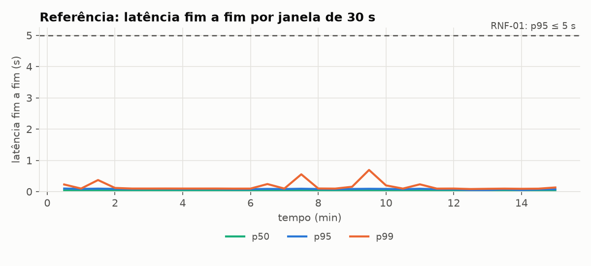

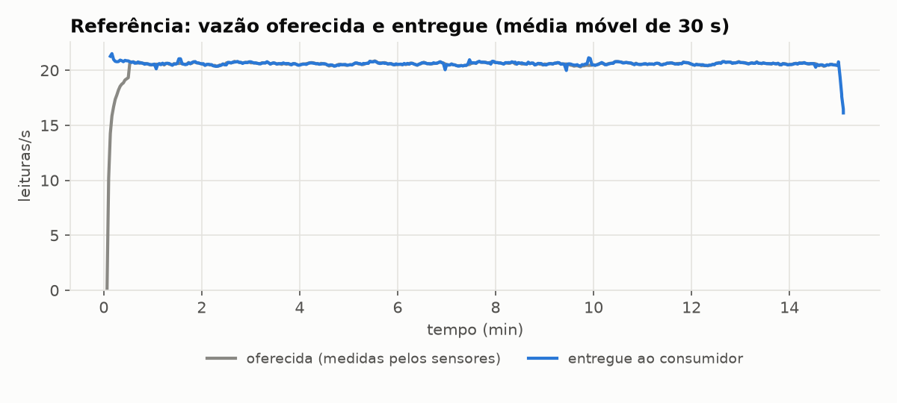

Com o perfil do RNF-03, a vazão entregue acompanha a oferta durante os 15
minutos. A latência p95 fica entre 50 e 100 ms em todas as janelas de 30 s, e a
maior fila de assinante no primário foi de 1 leitura. A restrição de "latência
relaxada" do cenário (meta de 5 s) é atendida com folga de ~60×.

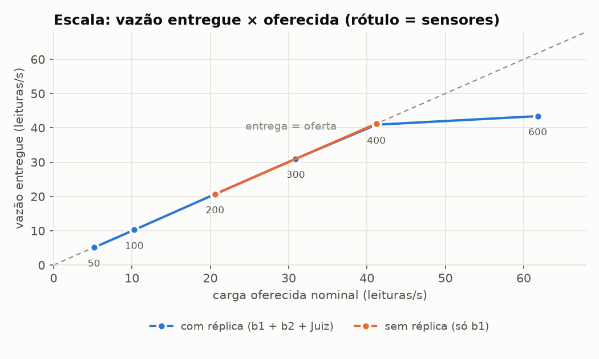

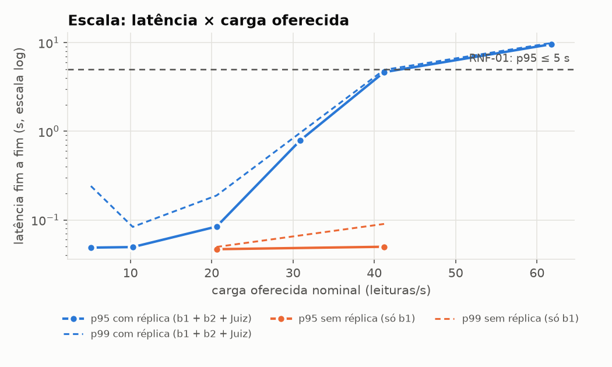

| Sensores | Oferta nominal (leituras/s) | Entregue com réplica | p95 com réplica | Entregue sem réplica | p95 sem réplica |
|---|---|---|---|---|---|
| 50 | 5,2 | 5,1 | 0,049 s | - | - |
| 100 | 10,3 | 10,2 | 0,049 s | - | - |
| 200 | 20,6 | 20,7 | 0,084 s | 20,7 | 0,047 s |
| 300 | 30,9 | 31,0 | 0,791 s | - | - |
| 400 | 41,2 | 40,9 | 4,644 s | 41,2 | 0,050 s |
| 600 | 61,8 | **43,4** (saturado) | 9,610 s | - | - |

O que o experimento de escala mostra:
- **Teto de ~43 leituras/s com réplica**, cerca de **2× a carga do perfil de
  referência** (e ~420 sensores com o mesmo mix). A latência segue abaixo de
  1 s até 300 sensores, chega a 4,6 s com 400 e passa da meta de 5 s na
  saturação.
- **A causa do teto é o disco.** Cada leitura tem 2 fsyncs em série sob o lock
  do store (no primário e na reserva), ~20 ms no total, o que dá um máximo
  teórico de ~50 leituras/s; a diferença para os 43 medidos é a rede, a
  entrega e o CPU compartilhado.
- **Sem a reserva**, 400 sensores (41/s) ficam com p95 de 50 ms. A
  replicação síncrona é, portanto, o principal custo de desempenho do
  projeto. É o preço do RPO = 0 sob `kill -9`, e para o cenário A (baixo
  volume) o teto de 2× a carga de referência é aceitável.
- **Na saturação (600 sensores), nada se perde.** As leituras esperam no
  buffer persistente dos sensores e são entregues depois; só a latência
  sobe. O próprio simulador desacelera, porque a biblioteca mantém um
  `PUBLISH` em voo por sensor.

### 5.3 Justiça entre sensores (RNF-05)

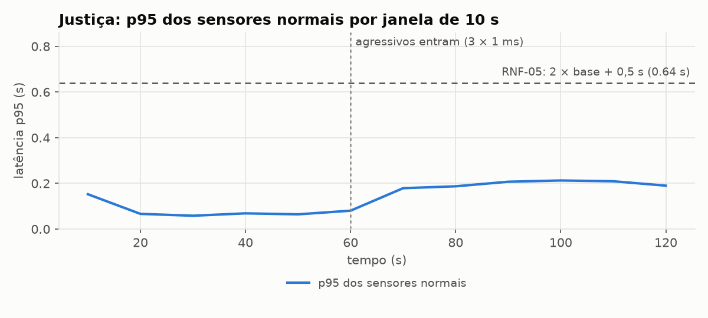

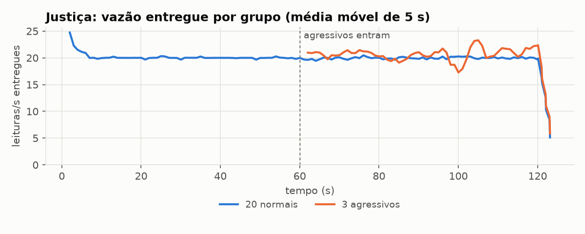

**Em vazão, a justiça é atendida.** Quando os 3 sensores agressivos (intervalo
de 1 ms) entram, os 20 sensores normais continuam recebendo tudo o que
produzem (20 leituras/s; 2.390 em 2 min, sem perda e sem fila). Os agressivos
ficam só com a capacidade que sobra (~22 leituras/s), e o excesso deles fica
no buffer deles. Isso é a fila justa (DP-18) somada ao backpressure por
sensor.

**Em latência, os normais ficam um pouco mais lentos:** o p95 sobe de
0,069 s para 0,203 s. Isso atende o RNF-05 revisto (limite de 2 × 0,069 +
0,5 = 0,638 s), mas seria reprovado pelo critério original, só relativo
(2,93× contra 2×). O atraso extra (~130 ms) tem duas causas:

1. **Na entrada, a gravação não é preemptiva.** A fila justa põe a leitura
   normal à frente das dos agressivos, mas, se o store está gravando e
   replicando uma leitura de agressivo, ela espera essa gravação terminar
   (~20 ms).
2. **Na saída, a fila do assinante é FIFO e compartilhada.** A fila justa age
   só na entrada. Depois de gravada, a leitura normal entra na fila do
   consumidor atrás das leituras dos agressivos que já estão lá (até 5 no
   cenário), e a entrega é uma por vez, esperando cada `DELIVER_ACK`.

Pelo tamanho do atraso, maior que uma gravação, a segunda causa
provavelmente responde pela maior parte, mas a divisão entre as duas não foi
medida.

Duas observações para interpretar o número:
- **Em valor absoluto o efeito é pequeno**: 0,203 s contra os 5 s do RNF-01.
  O critério original de "2× a linha de base" ficou mais rígido justamente
  porque a base caiu (0,097 s antes do ajuste e 0,056 a 0,069 s depois): 2× a
  base são hoje só 110 a 140 ms, ou poucos fsyncs. Foi isso que motivou a folga absoluta de
  0,5 s (seção 7.3).
- **O quociente é instável**: os percentis são estimados por buckets do
  histograma (bordas em 50, 100 e 250 ms). Com o sistema e o cenário
  idênticos, duas execuções depois do ajuste deram 3,14× (0,056 → 0,175 s) e
  2,93× (0,069 → 0,203 s, a do gráfico acima).

As melhorias técnicas possíveis estão na seção 8.

### 5.4 Rajada e sensores intermitentes

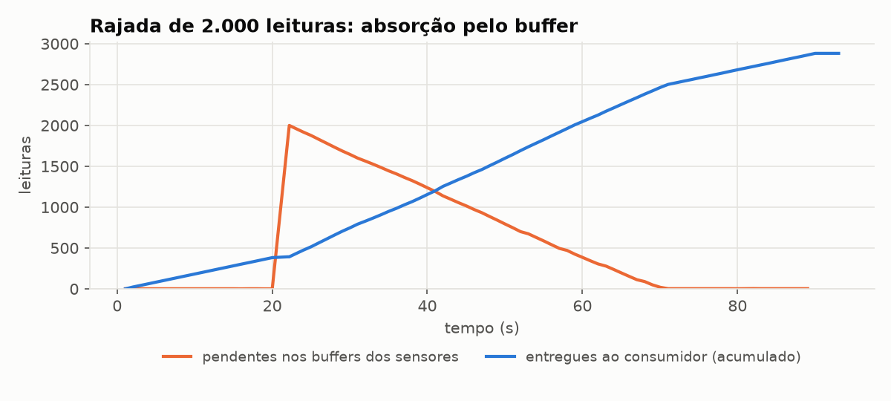

A rajada de 2.000 leituras aos 20 s vai direto para o buffer persistente dos
sensores e é drenada em ~50 s (~40 leituras/s, perto do teto), sem conexão
recusada e sem perda (RNF-04). Enquanto isso, o fluxo normal dos outros
sensores continua.

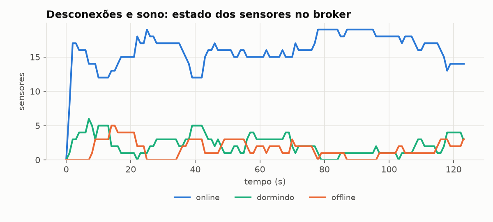

Com desconexões e ciclos de sono sorteados, o broker publica as transições
`dormindo` (44), `offline` (25, quando o sensor acorda depois do prazo) e
`online`. As 1.968 leituras foram todas entregues: as feitas offline saíram do
buffer na reconexão, em ordem.

### 5.5 Consumidor lento

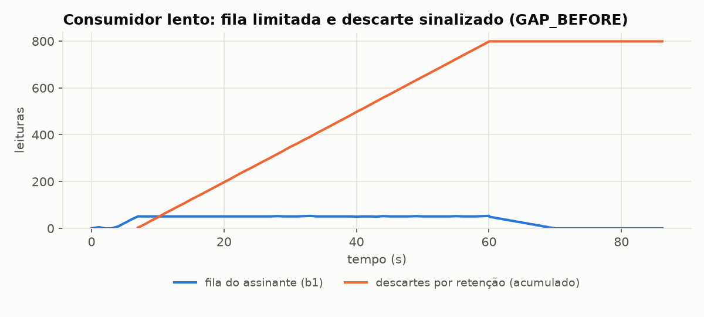

O consumidor recebe em média 6,5 mensagens/s contra 20 produzidas. A fila dele no
broker para em 50 (a retenção configurada), e o excesso é descartado: 799
descartes, sinalizados em 86 marcas `GAP_BEFORE`. Nenhuma lacuna chega sem
marca, e os sensores e os outros consumidores não são afetados (DP-07). A
perda aqui é uma escolha do projeto (memória limitada, RNF-17) e é **explícita**.

### 5.6 Falhas: queda do primário e do Juiz

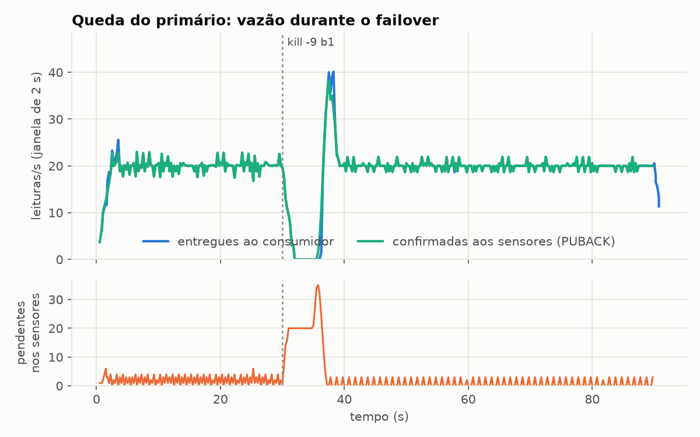

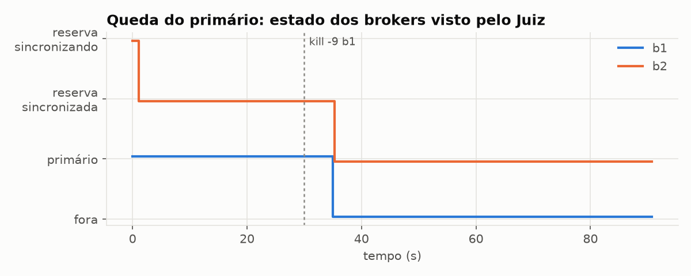

No `kill -9` do primário aos 30 s:
- as entregas param e as leituras novas ficam no buffer dos sensores (~20 pendentes);
- o Juiz declara o `b1` fora depois do prazo de falha (5 s) e promove o `b2`;
- os clientes reconectam pelo vip sem nenhuma configuração nova; o
  consumidor volta a receber **6,28 s** depois da queda (RTO; meta ≤ 30 s);
- os sensores esvaziam o buffer num pico de ~40 leituras/s e a vazão volta a
  20/s.

Nenhuma leitura confirmada se perdeu (RPO = 0), e **não houve nenhuma
duplicata**: o cursor de entrega também estava replicado na reserva. A
composição do RTO (prazo do Juiz + rodada de avaliação + backoff do cliente)
está em [ressalvas.md](ressalvas.md).

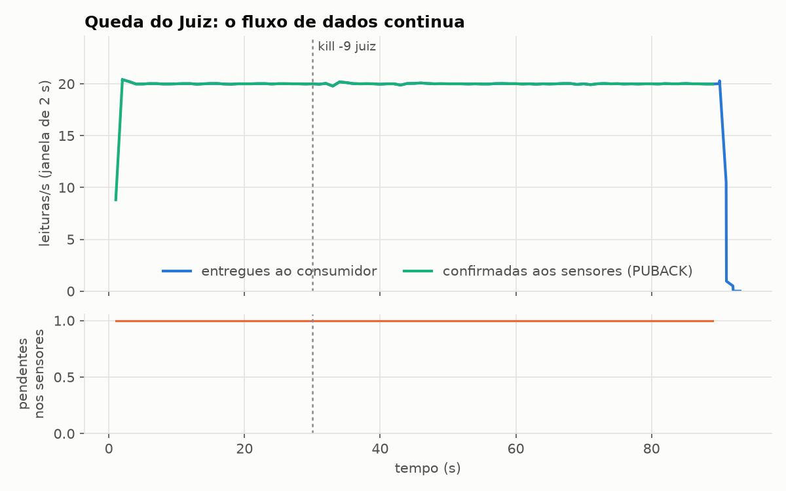

Com o `kill -9` no Juiz, o fluxo de dados não se altera (1.100 entregas entre
35 s e 90 s, sem perda): o Juiz não está no caminho dos dados (DP-08). Só o
failover fica suspenso até ele voltar.

## 6. Ajuste feito a partir das medições

### 6.1 O problema encontrado

A primeira bateria (antes do ajuste) reprovou o RNF-01 no perfil de
referência: **p95 de 9,66 s**, com a meta em 5 s. Os gráficos mostraram:
- a vazão entregue acompanhava a oferta, mas o sistema estava a ~90% da
  capacidade (teto de ~22 leituras/s contra 20,6/s oferecidas);
- o tempo até o `PUBACK` era baixo (p95 < 2 s), e a espera estava na **fila
  do assinante** no primário, com 120 leituras em média e até 213;
- sem a reserva, a mesma carga tinha p95 de 0,067 s.

A causa: a entrega a cada assinante é stop-and-wait, e o `DELIVER_ACK`
também era gravado com fsync e replicado de forma síncrona. Cada leitura
pagava **4 fsyncs em série** sob o lock do store (`PUBLISH` e `DELIVER_ACK`,
cada um no primário e na reserva). Com ~10 ms por fsync, isso dá ~25
leituras/s no máximo.

### 6.2 O ajuste

O **registro do `DELIVER_ACK` passou a ser gravado e replicado sem fsync**, no
primário e na reserva. As leituras (`PUBLISH`), as inscrições e os descartes
por retenção continuam com fsync. Os ACKs da aplicação continuam todos
existindo, e o formato do protocolo não mudou.

A justificativa é que os dois registros têm pesos diferentes:
- perder uma **leitura** confirmada seria perda de dado, o que o cenário não
  aceita;
- perder um **cursor** só faz o broker entregar de novo uma leitura que o
  consumidor já tem, e a deduplicação por `sensor_id + seq` a descarta.

O registro sem fsync sobrevive à queda do processo (`kill -9`), porque fica no
cache do SO, e chega ao disco no próximo fsync do store, que grava tudo o que
veio antes. Só numa queda da **máquina** os últimos cursores podem se perder,
e o efeito é duplicata, nunca perda. Para isso o log do store passou a
descartar a cauda inválida que uma queda dessas pode deixar
(`storage.WithUnsyncedTail`). A decisão foi registrada no DP-04 e em
[ressalvas.md](ressalvas.md), e é protegida por testes em `internal/storage`
e `internal/broker`.

### 6.3 Antes × depois

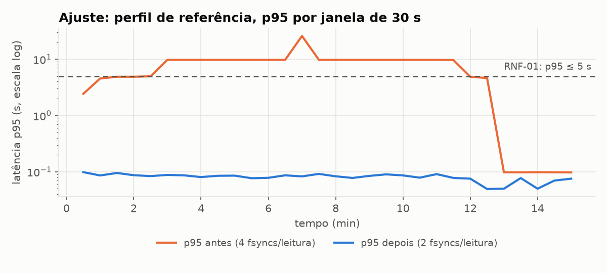

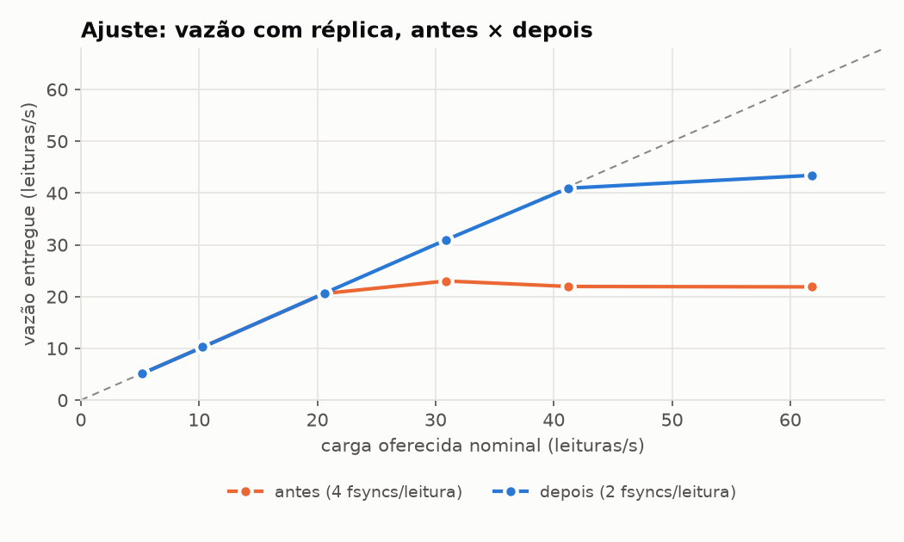

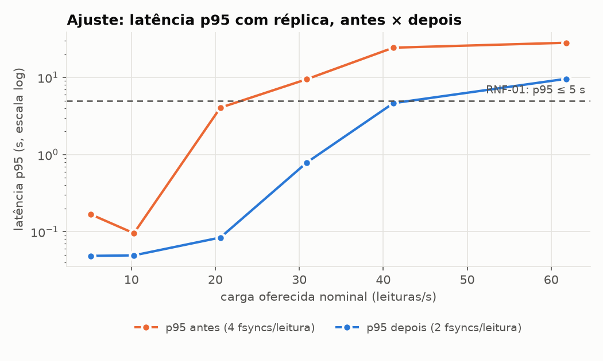

| Medida | Antes | Depois |
|---|---|---|
| fsyncs por leitura no broker (com réplica) | 4 | 2 |
| Teto de vazão com réplica | ~22 leituras/s | ~43 leituras/s |
| `referencia`: p95 / p99 | 9,66 s / 9,98 s ❌ | **0,082 s / 0,099 s** ✅ |
| `referencia`: maior fila do assinante | 213 | 1 |
| `escala_300`: vazão / p95 | 23,0/s / 9,50 s ❌ | 31,0/s / 0,79 s ✅ |
| `escala_400`: vazão / p95 | 22,0/s / 24,3 s ❌ | 40,9/s / 4,64 s ✅ |
| `queda_primario`: RTO | 7,24 s | 6,28 s |
| `justica`: p95 dos normais (base → teste) | 0,097 → 0,244 s (2,50×) | 0,069 → 0,203 s (2,93×) |

O ajuste trouxe o RNF-01 de volta com margem ampla e deu ao sistema folga de
~2× sobre o perfil de referência, sem tocar nas garantias de RPO = 0 e de
"pelo menos uma vez". Na justiça, a latência absoluta dos sensores normais
caiu, mas o quociente piorou, porque a base caiu mais (seções 5.3 e 7.3).

## 7. Dificuldades encontradas e como foram resolvidas

Esta seção registra os problemas que apareceram durante a avaliação e como
cada um foi tratado. Os que continuam em aberto estão na seção 8.

### 7.1 Latência acima da meta no perfil de referência (resolvido: p95 de 9,66 s → 0,082 s)

- **Problema:** a primeira bateria mediu p95 de 9,66 s, acima da meta de 5 s
  (RNF-01). Uma medição anterior, de 20/11, tinha dado 3,96 s, mas foi feita
  com o escalonamento antigo (round-robin) e não representava a versão final.
- **Diagnóstico:**
  - a vazão entregue acompanhava a oferta, então o sistema não estava perdendo
    leituras, mas a fila do assinante no primário ficava em ~120;
  - o tempo até o `PUBACK` era baixo (p95 < 2 s), então a espera estava na
    entrega, e não na publicação;
  - o controle sem réplica, com a mesma carga, deu p95 de 0,067 s, o que
    apontou a replicação síncrona;
  - medimos o custo de um fsync no disco da máquina, ~10 ms. Com 4 fsyncs em
    série por leitura, o teto ficava em ~22 leituras/s, contra 20,6/s
    oferecidas.
- **Alternativa descartada:** retirar os ACKs da aplicação e confiar só no ACK
  do TCP. O ACK do TCP só indica que os bytes chegaram ao sistema operacional
  do outro lado, não que a leitura foi gravada. Sem os ACKs da aplicação, o
  sensor não saberia quando pode apagar uma leitura do buffer, e a garantia
  cairia de "pelo menos uma vez" para "no máximo uma vez".
- **Resolução:** o registro do `DELIVER_ACK` passou a ser gravado sem fsync
  (seção 6). O p95 caiu para 0,082 s.

### 7.2 Risco introduzido pelo próprio ajuste (resolvido)

- **Problema:** com registros gravados sem fsync, uma queda de energia pode
  deixar vários registros incompletos ou zerados no fim do arquivo do store. A
  regra antiga tratava qualquer registro inválido no meio do arquivo como
  corrupção, e o broker não subiria depois da queda.
- **Resolução:** o log do store ganhou o modo `WithUnsyncedTail`, que descarta
  tudo a partir do primeiro registro inválido. Isso é seguro porque cada fsync
  grava todo o conteúdo anterior do arquivo: um trecho inválido só pode estar
  na cauda ainda não sincronizada, que contém apenas cursores de entrega. O
  comportamento é coberto por testes que corrompem e zeram essa cauda.

### 7.3 Meta de justiça: efeito de medição e revisão do critério (resolvido com revisão do RNF-05)

- **Problema:** em 20/11, o RNF-05 tinha passado com 1,05×. A análise por
  janela de 10 s mostrou que a janela de base incluía o pico de início do
  cenário, o que inflava a base e escondia o efeito dos sensores agressivos.
  Medido sem esse pico, o quociente era 2,50×.
- **Depois do ajuste:** o quociente foi a 3,14× na bateria e a 2,93× numa
  nova execução, embora a latência absoluta dos sensores normais tenha caído
  (0,244 s → ~0,2 s). O ajuste liberou
  capacidade, e os sensores agressivos passaram a ocupá-la; a base caiu mais
  do que o teste.
- **Diagnóstico do critério:** a base (0,056 a 0,069 s) é basicamente o custo
  de três fsyncs, então "2× a base" tolera só 56 a 69 ms de atraso extra. Qualquer
  disputa real pelo disco estoura esse limite, mesmo com a fila justa
  funcionando: os normais continuam recebendo 100% do que produzem. O critério
  puramente relativo pune o sistema por ser rápido, e é mais rígido do que a
  "latência relaxada" do cenário (RNF-01: 5 s).
- **Resolução:** o RNF-05 foi revisto, por decisão da equipe, para **2× a base
  + 0,5 s**. A folga de 0,5 s é 10% da meta do RNF-01 e não afeta o uso dos
  dados de temperatura. Um limite só relativo mais alto (3× ou 4×) foi
  descartado: o quociente oscila entre execuções por causa da estimativa por
  buckets (2,50×, 3,14× e 2,93× em três execuções), e um número escolhido logo
  acima do medido seria ajuste de meta ao resultado. Primeiro a meta revista
  foi avaliada sobre a execução da bateria (0,175 s contra o limite de
  0,612 s); depois o cenário foi rodado de novo com a meta nova no gerador e
  passou (0,203 s contra 0,638 s), e é essa execução que aparece nas seções
  5.1 e 5.3. O resultado pelo critério original continua informado nelas.

### 7.4 Falha intermitente do gerador de carga (contornado)

- **Problema:** numa das execuções, o cenário `offline_sono` não subiu: o vip
  recebeu uma porta já em uso. O gerador sorteia portas livres e as libera
  antes de iniciar os processos, e outro processo pode ocupá-las nesse
  intervalo.
- **Resolução:** o cenário foi repetido e passou. A correção do gerador ficou
  como trabalho futuro, porque não afeta os resultados medidos.

### 7.5 Interpretação dos dados de saturação (resolvido)

- **Problema:** nos cenários saturados (300 sensores ou mais), a carga medida
  nos sensores travava em ~23 leituras/s, porque o simulador desacelera junto
  com o broker (um `PUBLISH` em voo por sensor). Plotados contra essa carga, os
  pontos de 300, 400 e 600 sensores se sobrepunham e escondiam a saturação.
- **Resolução:** os gráficos de escala usam a carga **nominal**
  (sensores × 0,103 leitura/s), e a carga medida fica registrada em
  `escala.csv`.

### 7.6 Lição

A avaliação começou com a decisão de apenas medir e documentar, partindo da
premissa de que as metas seriam atingidas. A remedição completa, em vez de
reaproveitar os números anteriores, mostrou que a premissa não valia, e a
decisão foi revista antes de mexer no código. Medir o sistema inteiro de novo
depois do ajuste também mostrou que a justiça tinha mudado de forma: o
problema deixou de ser o sistema e passou a ser um critério que não
acompanhava a escala de latência do próprio sistema.

## 8. Limitações e trabalhos futuros

- **Justiça em latência.** O RNF-05 revisto é atendido, mas os sensores normais
  ainda esperam ~130 ms a mais com agressivos ativos. Para reduzir essa espera:
  - na saída: fila justa também na entrega, com uma subfila por
    sensor dentro da fila de cada assinante, para a leitura normal não
    esperar atrás das dos agressivos (ataca a segunda causa da seção 5.3);
  - na entrada: gravação agrupada (group commit, um fsync por lote de
    registros de várias sessões), o que encurta a espera atrás da gravação
    em andamento e também sobe o teto de vazão.
- **Teto de vazão preso ao fsync.** ~43 leituras/s com réplica bastam para o
  cenário A (2× a referência), mas não para cargas maiores. Group commit é a
  próxima alavanca.
- **Ambiente de uma máquina só.** Todos os processos dividem o mesmo disco e
  CPU, e a rede é local. Com brokers em máquinas separadas, a ida e volta de
  rede cresce e os fsyncs passam a ocorrer em discos diferentes; os números
  absolutos mudariam.
- **Queda da máquina não foi testada de ponta a ponta.** Os testes cobrem a
  cauda corrompida do store e o reinício do processo, mas não uma queda real
  de energia.
- **Juiz único** (DP-12): é ponto único de falha da coordenação. Sem ele, os
  dados seguem fluindo (comprovado em `queda_juiz`), mas não há failover.
- **Resolução dos percentis.** Os percentis vêm de buckets de histograma; o
  RNF-01 estimado em 9,66 s antes do ajuste significa "entre 5 e 10 s".
- **Runner.** Numa execução, o `offline_sono` não subiu por colisão de porta
  (o runner reserva portas livres e as libera antes de subir os processos).
  O cenário foi repetido e passou. A falha é intermitente e fica registrada
  como correção futura do runner.
- As demais limitações conhecidas (retenção por tempo do RF-39 não
  implementada, estado de sono só em memória, `GAP_BEFORE` sem a lista de
  `seq` perdidos etc.) estão em [ressalvas.md](ressalvas.md).

## 9. Como reproduzir

```bash
# pré-requisitos: Go 1.22 e Python 3 com venv (sudo apt install python3.12-venv)
./scripts/dev.sh graficos-setup            # matplotlib em .venv/

# um cenário (resultados em data/etapa3/<cenario>-<data>/)
go run ./examples/runner -cenario examples/cenarios/referencia.json -out data/etapa3

# escala e controle sem réplica
for f in examples/cenarios/escala/*.json; do
  go run ./examples/runner -cenario "$f" -out data/etapa3
done

# gráficos (usa a execução mais recente de cada cenário; -antes para a comparação)
./scripts/dev.sh graficos -dados data/etapa3 -saida docs/relatorio/graficos -antes data/etapa3-antes
```

Rode os cenários um por vez e sem outra carga na máquina; um cenário sozinho
leva de 2 a 15 minutos. Os valores numéricos dos gráficos de escala ficam em
[escala.csv](relatorio/graficos/escala.csv).
